**Desenvolvedor Java** · Análise e Desenvolvimento de Sistemas — PUC Minas

Estagiário na Energisa Corretora, criando automações e agentes de IA com Copilot Studio e Power Automate.

  

### Tecnologias

  

### Estatísticas

  

### Portfólio

Projetos, prints e detalhes em **[vecchiportfolio.vercel.app](https://vecchiportfolio.vercel.app)**
 
Código-fonte: <a href="https://github.com/DougVec/Portfolio-Douglas">Portfolio-Douglas</a>

